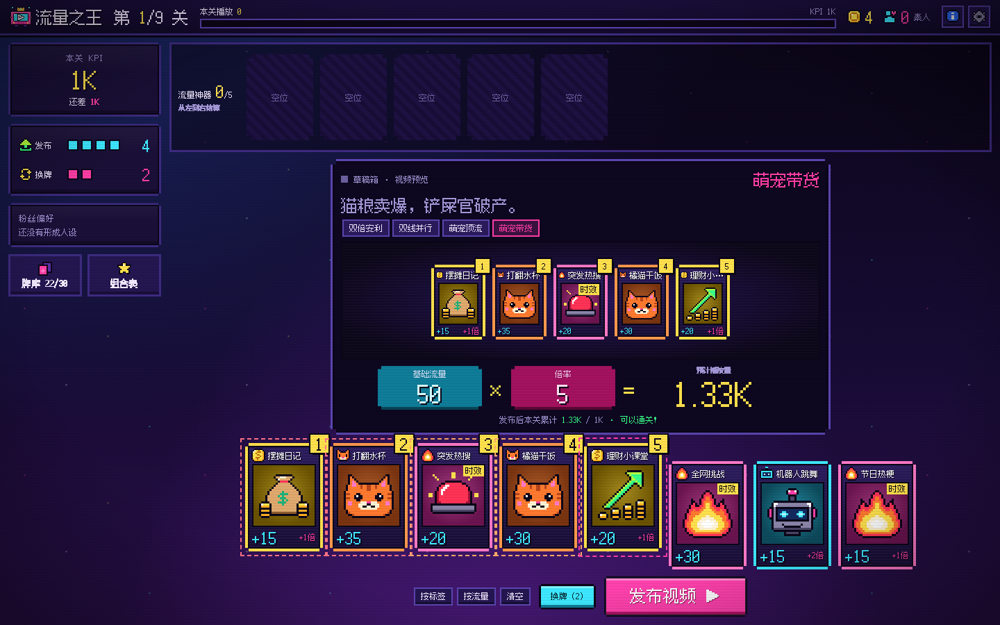
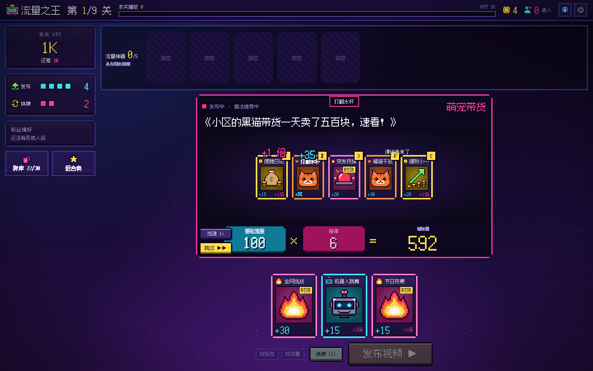
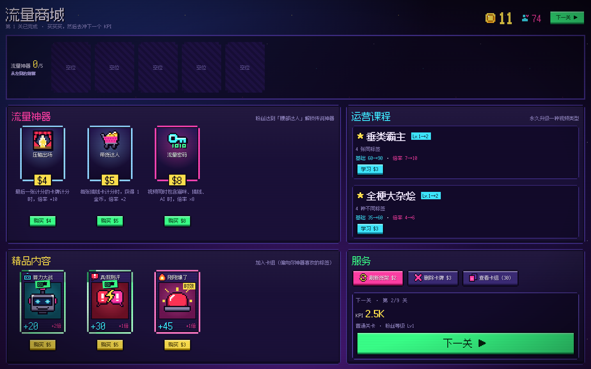
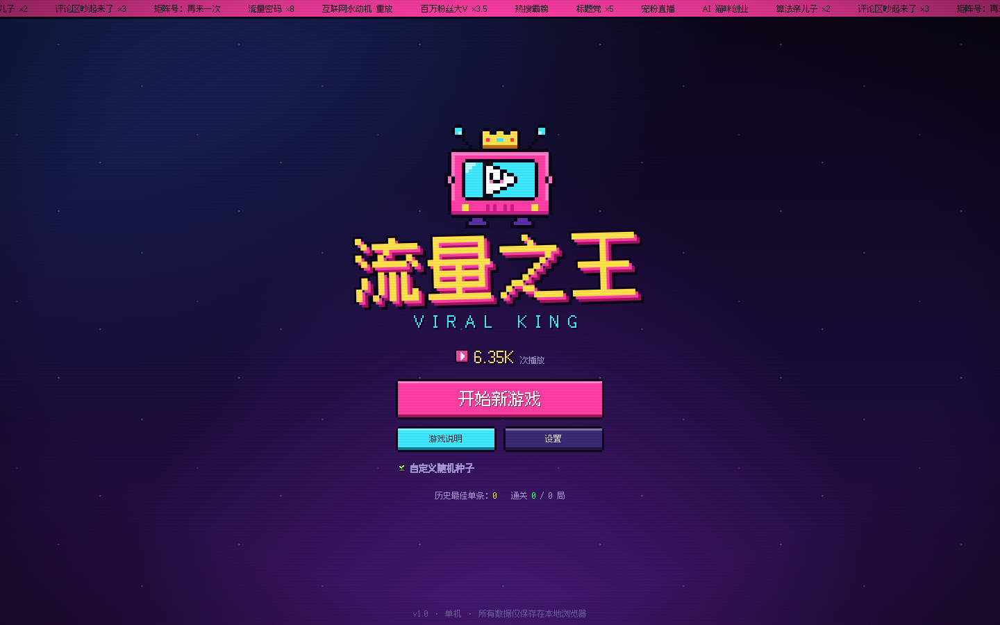

# 流量之王 · Viral King

**像素风短视频博主模拟器：拼内容卡发视频，靠流量神器连乘倍率，把播放量从几百滚到万亿。**

▶ **在线试玩：<https://viral-king.vercel.app>**（浏览器直接玩，不用安装）



| 发布结算：基础流量 × 倍率 | 视频结果卡 |
|---|---|
|  |  |
| **流量商城：神器、课程、精品卡** | **主菜单** |
|  |  |

一款以短视频平台和流量算法为题材的像素风 Roguelike 卡牌构筑游戏。你从零粉丝的素人博主起步，用内容卡组合视频、买流量神器、利用（也被利用）平台算法，让播放量从几百一路滚到百万、亿、万亿。

纯前端单机游戏，不需要后端、账号或任何网络 API。

## 快速开始

需要 Node.js 20+。

```bash
npm install
npm run dev        # 开发服务器，浏览器打开终端里显示的地址（默认 http://localhost:5173）
```

其他命令：

```bash
npm test           # 运行规则引擎的自动化测试（vitest）
npm run build      # 类型检查 + 生产构建，产物在 dist/
npm run preview    # 本地预览生产构建
npm run sim        # 平衡性模拟：贪心机器人跑 300 局，输出通关率和各关数据
npm run sim -- 1000 noshop   # 1000 局、不买东西的对照组
```

`dist/` 是纯静态文件（相对路径），可以直接丢到任何静态托管上。

## 怎么玩

1. 每关有一个**播放量 KPI**，你有 4 次发布、2 次换牌。
2. 手里 8 张内容卡，点击选最多 5 张。**点击顺序就是出场顺序**，有些神器看顺序。
3. 标签组合决定**视频类型**（22 种，例如 猫咪+搞笑=萌宠爆笑、AI+搞钱+争议+热点=超级财富热点），给出初始基础流量和倍率。预览区会实时显示视频类型和预计播放量。
4. 发布后逐步结算：**基础流量 × 倍率 = 播放量**。`×N` 是真正连乘。
5. 累计达到 KPI 即通关，拿金币进商店：买**流量神器**（28 个）、上**运营课程**（升级视频类型）、买**精品内容卡**、删卡精简卡组、刷新货架。
6. 第 3/6/9 关是 Boss（每局从 5 个中随机抽 3 个），会改规则。打通第 9 关就是流量之王。

快捷键：数字键 1–8 选牌，Enter 发布，D 换牌，结算中按空格加速，再按一次跳过。

## 核心系统

| 系统 | 说明 |
|---|---|
| 内容标签 | 猫咪（高基础）、AI（自带倍率）、搞钱、搞笑（倍率）、争议（数值波动大）、热点（本关首发基础 ×2） |
| 卡牌属性 | 高清 +40 基础、爆梗 +4 倍率、金曲 ×1.5、回声 再触发一次、恰饭 +1 金币 |
| 流量神器 | 28 个，4 种稀有度。包括加基础、加倍率、乘倍率、重复触发、复制其他神器、按粉丝/标签数量/卡牌顺序/历史发布加成、循环重放 |
| 粉丝 | 每条视频获得 ≈ 播放量^0.6 个粉丝，跨关保留。提供初始曝光（基础 +√粉丝）、每关商单金币、激活「铁粉团」、在「腰部达人」时解锁传说神器、解锁「宠粉直播」视频类型 |
| Boss | 算法大改版、内容审核风暴、观众审美疲劳、平台限流、系统维护 |
| 视频标题 | 本地模板 + 词库随机拼接，会避开最近用过的标题 |

### 结算顺序（确定性）

1. 视频类型 → 初始基础与倍率；粉丝初始曝光。
2. 被 Boss 限流的卡牌被剔除（不计分、不参与组合）。
3. 计分卡牌**从左到右**：卡牌自身数值 → 属性 → 铁粉偏好 → 神器栏从左到右的 `onCard` 反应。重复触发时整张卡重新结算一遍；重复触发次数在卡牌开始结算前一次性算好，所以重复触发不会再引出重复触发。
4. 神器栏从左到右的独立效果（`onVideo`）。
5. Boss 惩罚。

防失控措施：每张卡最多额外触发 5 次；复制链遇到环（二创鬼才 ↔ 抄作业）直接失效；互联网永动机每个实例每条视频只重放一次，而且不重放「重放」本身；所有数值经过 `safeMul/safeAdd`，上限 1e300，所以不会出现 NaN 或 Infinity。显示会缩写成 K/M/B/T/Qa…，超出缩写表后用科学计数法。

### 数值缩放说明

需求示例里「猫咪统治互联网 +200」这类数字，是按本作的卡牌数值（单卡 5–45）等比缩小后重新定的（+50），否则开局就会失衡。所有可调参数都在 `src/data/balance.ts`，KPI 曲线是用 `npm run sim` 调出来的：贪心机器人（不会调整神器顺序）的通关率在 35–40% 左右，死亡分散在三个 Boss 关和后期，强构筑单条可以到亿级甚至更高。

## 项目结构

```
src/
  engine/            纯函数规则引擎（不依赖 DOM，可在 Node 里测试）
    types.ts         所有状态与结算类型
    rng.ts           可序列化的种子随机数（mulberry32），整局状态只存一个 uint32
    num.ts           安全数值运算与 K/M/B/T 格式化
    context.ts       神器效果的上下文接口与钩子定义
    scoring.ts       计分管线：限流 → 视频类型 → 卡牌 → 神器 → Boss，产出逐步 steps
    game.ts          状态机：开局、抽牌/换牌/发布、结算、奖励、商店、存档校验
    titles.ts        标题生成
  data/              数据驱动配置：cards / tags / combos / artifacts / bosses / titles / balance
  state/store.ts     应用状态（useSyncExternalStore）+ localStorage 存档/设置/历史记录
  audio/sfx.ts       WebAudio 合成音效与 8-bit 背景音乐（没有音频文件）
  fx/fx.ts           Canvas 像素粒子、屏幕震动、飘字
  art/               像素精灵（字符矩阵 + 调色板）与渲染器
  ui/                React 组件、各页面、对局界面
  styles/            CSS（像素边框、CRT、动画、响应式）
tests/               vitest：计分、乘法链、重复触发、复制、Boss、卡组、商店、胜负、可复现性
scripts/simulate.ts  平衡性模拟器
```

### 加一个新神器

在 `src/data/artifacts.ts` 里加一项，写上 `hooks`（`onCard` / `retrigger` / `onVideo` / `onDiscard` / `onStageStart`），再在 `src/art/sprites/artifacts.ts` 里画一个 16×16 图标就行。效果通过 `ctx.addBase / addMult / xMult / xBase / addCoins / setState` 产出结算步骤，动画会自动跟上。

## 存档与种子

- 每次操作后自动存到 `localStorage`，刷新页面会回到原来的位置。结算动画中途刷新，会直接显示那条视频的结果卡。
- 新游戏可以在主菜单「自定义随机种子」里填种子；同一个种子加同样的操作，整局完全一样。游戏内设置面板里能复制当前种子，结局页可以「同种子重来」。
- 设置项：音效/音乐/音量、动画速度 1×/2×/4×、屏幕震动、粒子、CRT 扫描线、重新显示新手引导。

## 素材与许可

- 美术：全部是代码里的像素精灵（`src/art/sprites`），运行时渲染成图片。
- 音效与音乐：WebAudio 实时合成。
- 字体：[缝合像素字体 Fusion Pixel Font](https://github.com/TakWolf/fusion-pixel-font)（12px 简体中文），SIL Open Font License 1.1，许可文本见 `public/fonts/OFL-fusion-pixel.txt`。
